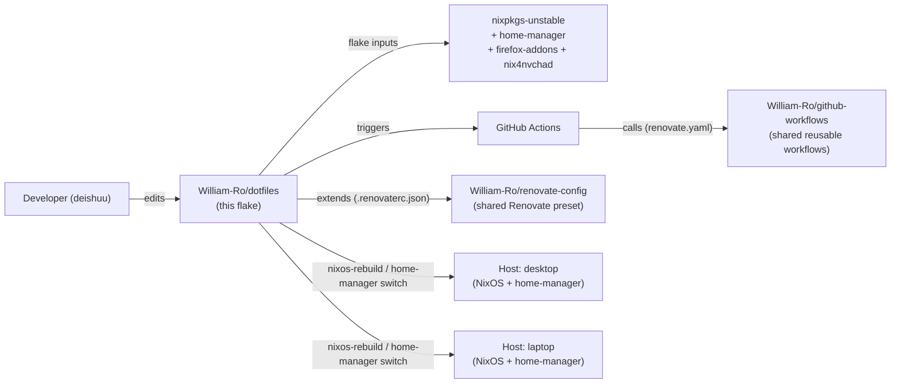
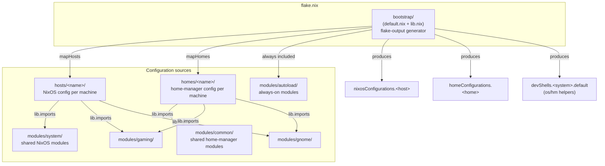
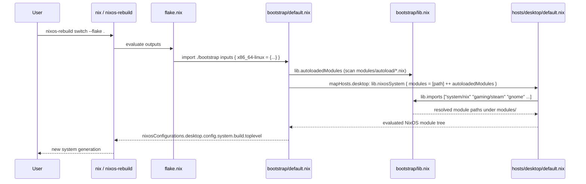

# Architecture

|             |                                            |
| ----------- | ------------------------------------------ |
| Remote      | `git@github.com:William-Ro/dotfiles`       |
| Branch      | `main`                                     |
| HEAD commit | `7622a92a1a0852fe2f2be8dcc38f4b83affad6c2` |
| License     | None found in checkout `[UNVERIFIED]`      |

This document describes the repository as of the commit above. It is generated
from the files on disk; claims are cited to a path, and anything not directly
confirmed is marked `[INFERRED]` or `[UNVERIFIED]`.

## Part 1 — Whole-repo technical deep-dive

### What this repository is

> "Declarative Nix system and user environment configuration managed from a
> single Git source. This repository contains reusable and modular
> configuration for Linux machines, including system setup, shell environment,
> development tooling, desktop customization, and personal workflows."
> — [`README.md`](README.md)

It is a single Nix flake ([`flake.nix`](flake.nix)) that declares both NixOS
system configurations and home-manager user configurations for two physical
machines (`desktop`, `laptop`), built from a shared pool of modules.

### Tech-stack detection table

| Layer                          | Technology                                                     | Evidence                                                                                                     |
| ------------------------------ | -------------------------------------------------------------- | ------------------------------------------------------------------------------------------------------------ |
| Package/config language        | Nix (flakes)                                                   | [`flake.nix`](flake.nix)                                                                                     |
| OS configuration               | NixOS, `nixpkgs-unstable` channel                              | [`flake.nix#L6`](flake.nix)                                                                                  |
| User-environment configuration | home-manager (`nix-community/home-manager`, follows `nixpkgs`) | [`flake.nix#L8-L11`](flake.nix)                                                                              |
| Firefox extensions             | `rycee/nur-expressions` (`firefox-addons` flake input)         | [`flake.nix#L13-L17`](flake.nix)                                                                             |
| Neovim distro                  | `nix4nvchad`                                                   | [`flake.nix#L19-L23`](flake.nix), [`modules/common/nvchad.nix`](modules/common/nvchad.nix)                   |
| Formatter                      | `nixfmt` (RFC-style)                                           | [`bootstrap/default.nix#L31,L68`](bootstrap/default.nix), CI `nixfmt --check`                                |
| Lint (non-blocking)            | `deadnix`, `statix`                                            | [`.github/workflows/ci-pr.yml`](.github/workflows/ci-pr.yml)                                                 |
| Dependency automation          | Renovate, via shared org config + shared reusable workflow     | [`.renovaterc.json`](.renovaterc.json), [`.github/workflows/renovate.yaml`](.github/workflows/renovate.yaml) |
| CI runner                      | GitHub Actions, `cachix/install-nix-action`                    | [`.github/workflows/ci-pr.yml`](.github/workflows/ci-pr.yml)                                                 |
| Desktop environment            | GNOME (Wayland, GDM)                                           | [`modules/gnome/default.nix`](modules/gnome/default.nix)                                                     |
| Containers                     | Podman (Docker-compatible socket)                              | [`modules/system/virtualisation.nix`](modules/system/virtualisation.nix)                                     |
| GPU (desktop only)             | NVIDIA proprietary driver, `.stable` channel                   | [`hosts/desktop/nvidia.nix`](hosts/desktop/nvidia.nix)                                                       |

### Entry points

There is no running application; the "entry point" is the flake's `outputs`
function, consumed by the Nix CLI:

1. **`nix build`/`nixos-rebuild switch --flake .#<host>`** evaluates
   [`flake.nix`](flake.nix) → [`bootstrap/default.nix`](bootstrap/default.nix)
   → produces `nixosConfigurations.<host>`, the full system closure.
2. **`home-manager switch --flake .#<home>`** evaluates the same bootstrap
   path's `mapHomes`, producing `homeConfigurations.<home>`, the user
   environment closure.
3. **`nix develop`** drops into `devShells.<system>.default`
   ([`bootstrap/default.nix#L58-L75`](bootstrap/default.nix)), which exposes
   two shell functions, `os` (`nixos-rebuild switch --flake .#$1`) and `hm`
   (`home-manager switch --flake .#$1`), as the documented way to apply either
   configuration — there is no separate deploy script.

### Commands & Verification Inventory

| Command                                                                                 | Purpose                                                              | Evidence                                                                  |
| --------------------------------------------------------------------------------------- | -------------------------------------------------------------------- | ------------------------------------------------------------------------- |
| `nix shell nixpkgs#nixfmt --command find . -name "*.nix" ... -exec nixfmt --check {} +` | Format check, all `.nix` files                                       | [`.github/workflows/ci-pr.yml`](.github/workflows/ci-pr.yml) `syntax` job |
| `nix flake check --no-build`                                                            | Evaluate the flake (schema/type errors) without building derivations | same job                                                                  |
| `nix shell nixpkgs#deadnix --command deadnix --exclude result`                          | Dead-code lint                                                       | same job, `continue-on-error: true` — **not blocking**                    |
| `nix shell nixpkgs#statix --command statix check`                                       | Nix anti-pattern lint                                                | same job, `continue-on-error: true` — **not blocking**                    |
| `nixos-rebuild switch --flake .#<host>` (via the `os` devShell helper)                  | Apply a NixOS system configuration to a live host                    | [`bootstrap/default.nix#L73`](bootstrap/default.nix)                      |
| `home-manager switch --flake .#<home>` (via the `hm` devShell helper)                   | Apply a home-manager user configuration                              | [`bootstrap/default.nix#L70`](bootstrap/default.nix)                      |

**CI enforcement:** `CI PR` (`syntax` job: format + flake check, lint
non-blocking) runs on every `pull_request` targeting `main`, regardless of
which files changed — an earlier path filter (`**/*.nix`, `flake.lock`,
`.github/workflows/**`) was removed because it meant docs/instructions-only
PRs (e.g. this one) triggered no checks at all, same gap
`William-Ro/homelab` hit and fixed (see
[decisions/0001](docs/decisions/0001-run-ci-on-every-pr-no-path-filter.md)).
It also runs on `push` to `renovate/**` branches, so Renovate's branch
automerge (the default for `digest`/`minor`/`patch`/`pin` flake input bumps —
see `.renovaterc.json`) has a status to merge against instead of hanging
forever waiting on a check that would never run (see
[decisions/0003](docs/decisions/0003-gate-renovate-branch-automerge-with-ci.md)).
This is now the **only** validation workflow besides `Renovate` — a former
`ci-main.yml`
(post-merge dry-run build of both hosts) and `auto-format.yml` (weekly
auto-formatting PR) were removed to match the same minimal two-workflow shape
`William-Ro/homelab` uses (`renovate.yaml` + `ci-pr.yml`), now that all changes
are expected to go through a PR. Confirmed via the GitHub API: `main`'s
ruleset requires a pull request and the `Syntax & Lint` status check before
merging (see
[decisions/0002](docs/decisions/0002-enforce-pr-required-workflow.md)) — a
GitHub App integration (Renovate) can still bypass the PR requirement for
branch automerge, but the required status check still applies to it. There is
no test suite in the conventional sense, and **no CI step builds anything**
anymore — `nix
flake check` (schema-level) is the closest automated equivalent to a "test";
run the `nixosConfigurations`/`homeConfigurations` dry-run builds yourself
before opening a PR (see Developer gotchas below).

### Directory layout

| Path                                             | Purpose                                                                                                                                                                                                           |
| ------------------------------------------------ | ----------------------------------------------------------------------------------------------------------------------------------------------------------------------------------------------------------------- |
| [`flake.nix`](flake.nix)                         | Declares flake inputs and calls `bootstrap/` with the `{ hosts, homes }` map for `x86_64-linux`.                                                                                                                  |
| [`bootstrap/default.nix`](bootstrap/default.nix) | The flake-output generator: turns `{ hosts, homes }` into `nixosConfigurations`, `homeConfigurations`, `formatter`, and `devShells` for each system.                                                              |
| [`bootstrap/lib.nix`](bootstrap/lib.nix)         | Custom `lib` extensions: `autoloadedModules` (auto-discovers every `.nix` file under `modules/autoload/`) and `imports` (a helper that resolves bare strings like `"system/nix"` to `../modules/system/nix.nix`). |
| `hosts/<name>/`                                  | One directory per physical machine's NixOS configuration (`default.nix`, `hardware-configuration.nix`, plus machine-specific extras like `desktop/nvidia.nix`).                                                   |
| `homes/<name>/`                                  | One directory per machine's home-manager user configuration — note the directory is keyed by **machine name**, not username; there is one home profile per host, not per-user.                                    |
| `modules/autoload/`                              | Modules applied to **every** NixOS and home-manager configuration automatically, with no explicit import — discovered by filename at eval time ([`bootstrap/lib.nix#L4-L9`](bootstrap/lib.nix)).                  |
| `modules/common/`                                | Home-manager modules shared by both machines' home profiles (shell, editor, git, terminal apps, desktop apps), explicitly imported via `lib.imports [...]`.                                                       |
| `modules/system/`                                | NixOS system-level modules shared by both hosts (nix daemon settings, system packages/fonts, locale, audio, virtualisation).                                                                                      |
| `modules/gaming/`                                | Steam/gaming-related home-manager module, opted into by both home profiles.                                                                                                                                       |
| `modules/gnome/`                                 | GNOME desktop environment: NixOS-level enablement (`default.nix`) plus home-manager-level extensions/dconf settings (`extensions.nix`, `settings.nix`).                                                           |
| `.github/workflows/`                             | `ci-pr.yml`, `renovate.yaml` (see Commands table above).                                                                                                                                                          |
| `.renovaterc.json`                               | Extends the shared `William-Ro/renovate-config` preset; adds nix-specific lockfile-maintenance scheduling and groups all flake-input bumps into one PR.                                                           |
| `flake.lock`                                     | Pins exact revisions of all flake inputs; Renovate's `lockFileMaintenance` keeps it current weekly.                                                                                                               |

### Deployment & Runtime Surface

| Component                                           | Version pin                                                                | Evidence                                                                                                                                                                                                                                           |
| --------------------------------------------------- | -------------------------------------------------------------------------- | -------------------------------------------------------------------------------------------------------------------------------------------------------------------------------------------------------------------------------------------------- |
| `nixpkgs`                                           | `nixpkgs-unstable` (rolling, pinned only by `flake.lock` revision)         | [`flake.nix#L6`](flake.nix)                                                                                                                                                                                                                        |
| `home-manager`                                      | Tracks `nixpkgs` via `inputs.nixpkgs.follows`                              | [`flake.nix#L9-L11`](flake.nix)                                                                                                                                                                                                                    |
| NixOS/home-manager state version (both hosts/homes) | `"24.05"`                                                                  | [`hosts/desktop/default.nix#L55`](hosts/desktop/default.nix), [`hosts/laptop/default.nix#L52`](hosts/laptop/default.nix), [`homes/desktop/default.nix#L37`](homes/desktop/default.nix), [`homes/laptop/default.nix#L36`](homes/laptop/default.nix) |
| NVIDIA driver (desktop only)                        | `nvidiaPackages.stable` (switched from `.latest` after a crash regression) | [`hosts/desktop/nvidia.nix#L28-L38`](hosts/desktop/nvidia.nix)                                                                                                                                                                                     |
| CI runner image                                     | `ubuntu-latest` (GitHub-hosted)                                            | all workflow files                                                                                                                                                                                                                                 |
| `cachix/install-nix-action`                         | pinned by commit SHA, `# v31`                                              | [`.github/workflows/ci-pr.yml#L28`](.github/workflows/ci-pr.yml)                                                                                                                                                                                   |

`system.stateVersion`/`home.stateVersion` are compatibility markers for
on-disk format/default changes, not a "current version" field — NixOS/HM
guidance is to leave them unchanged after initial install even while tracking
`unstable`, so `"24.05"` here is expected, not stale. `[INFERRED]` from
standard NixOS/home-manager convention.

### EOL / dead-dependency scan

- No EOL runtimes found: `nixpkgs-unstable` and `home-manager` (following it)
  are continuously rolling and kept current by Renovate's weekly
  `lockFileMaintenance` ([`.renovaterc.json#L7-L13`](.renovaterc.json)).
  `[INFERRED]`.
- The NVIDIA driver pin has a documented, intentional downgrade from
  `.latest` to `.stable` due to a `gnome-shell` crash regression, with a
  revert condition noted inline
  ([`hosts/desktop/nvidia.nix#L28-L38`](hosts/desktop/nvidia.nix)) — not
  neglect, a live tradeoff to revisit.
- `boot.initrd.systemd.enable` was removed from host configs because the
  "scripted initrd" it toggled was itself removed upstream (commit `d684f15`,
  `git log`) — evidence of the repo actively tracking `nixpkgs-unstable`
  breaking changes rather than pinning around them.

### Data/storage, APIs, background jobs, CI/CD, testing

- **Data/storage:** none — this is host/user configuration, not an
  application with its own datastore.
- **APIs:** none authored here; the only "API" is the Nix flake output schema
  (`nixosConfigurations`, `homeConfigurations`, `devShells`, `formatter`)
  that `nix`/`nixos-rebuild`/`home-manager` consume.
- **Plugins/extensions:** `modules/` is the repo's extension mechanism —
  `modules/autoload/` for always-on modules, everything else opted in per
  host/home via `lib.imports [...]` string paths.
- **Background jobs:** none authored; `nix.gc` (weekly store garbage
  collection) and `nix.optimise.automatic`
  ([`modules/system/nix.nix#L36-L40`](modules/system/nix.nix)) are
  NixOS-managed systemd timers that behave like background jobs once applied.
- **CI/CD:** see Commands & Verification Inventory above. There is no
  "deploy" step in CI — applying a configuration to a physical machine is a
  manual, host-side `os`/`hm` invocation; CI only checks that the flake
  evaluates/formats/builds.
- **Testing:** no test suite; `nix flake check --no-build` (schema-level,
  pre-merge in `ci-pr.yml`) is the closest automated analog. Nothing in CI
  builds a host or home anymore — run the dry-run build commands yourself
  (see Commands & Verification Inventory) before opening a PR.

## Part 2 — Context & ecosystem

### Checkout identity

See the table at the top of this document.

### Repo-specific agent/contributor docs present

| File                                                                                                 | Encodes                                                                                                                                  |
| ---------------------------------------------------------------------------------------------------- | ---------------------------------------------------------------------------------------------------------------------------------------- |
| [AGENTS.md](AGENTS.md)                                                                               | Short router to this document, `.github/copilot-instructions.md`, both scoped instructions files, and `docs/`.                           |
| [.github/copilot-instructions.md](.github/copilot-instructions.md)                                   | Always-loaded repo conventions and validation commands.                                                                                  |
| [.github/instructions/nix-modules.instructions.md](.github/instructions/nix-modules.instructions.md) | Scoped (via `applyTo`) to `hosts/**/*.nix`, `homes/**/*.nix`, `modules/**/*.nix`, `bootstrap/**/*.nix` — module/host-adding conventions. |
| [.github/instructions/pr-workflow.instructions.md](.github/instructions/pr-workflow.instructions.md) | Branch/commit/push/PR workflow and Conventional Commits format.                                                                          |

No `CONTRIBUTING.md` or `CODEOWNERS` file found. `[UNVERIFIED beyond a
root/.github listing]`.

### Developer gotchas (each cited)

- **`homes/<name>/` is keyed by machine, not by user.** There is one home
  profile per host (`desktop`, `laptop`), not a reusable per-username profile
  — adding a second user on the same machine isn't a supported shape today
  without restructuring. `[INFERRED]` from `flake.nix#L23-L26` and the
  `homes`/`hosts` directory layout.
- **`modules/autoload/` applies to every configuration with no explicit
  import** — a new file dropped there silently becomes global. This is by
  design ([`bootstrap/lib.nix#L4-L9`](bootstrap/lib.nix)), but easy to forget
  when adding a file to that specific directory versus `modules/common/` or
  `modules/system/`.
- **`lib.imports` resolves bare strings relative to `modules/`,** trying a
  directory's `default.nix` first, then `<path>.nix`
  ([`bootstrap/lib.nix#L13-L24`](bootstrap/lib.nix)) — a typo'd string import
  fails at eval time with a Nix path error, not a clear "module not found"
  message.
- **CI does not build anything, anywhere, anymore** — `ci-pr.yml` only
  formats/lints/flake-checks; the post-merge dry-run build that used to live
  in `ci-main.yml` was removed along with that workflow. A change that
  evaluates fine but fails to actually build is caught only if someone runs
  the dry-run build commands locally (see Commands & Verification Inventory).
- **`main` now has a required-PR and required-status-check rule** — the
  ruleset requires a pull request plus the `Syntax & Lint` check to pass
  before merging (see
  [decisions/0002](docs/decisions/0002-enforce-pr-required-workflow.md)).
  Direct `git push` to `main` is rejected; only Renovate's Integration bypass
  actor can merge without a PR, and even then the status check still applies.

### Relationship to broader ecosystem (as visible from disk)

- Renovate configuration extends `github>William-Ro/renovate-config//default.json5`
  — the same shared preset repo `William-Ro/homelab` uses
  ([`.renovaterc.json#L3-L5`](.renovaterc.json)).
- The `Renovate` workflow itself is not authored here; it calls the shared
  reusable workflow `William-Ro/github-workflows/.github/workflows/renovate.yaml`,
  pinned to a commit SHA
  ([`.github/workflows/renovate.yaml#L13`](.github/workflows/renovate.yaml)) —
  again, the same shared workflow `William-Ro/homelab` calls. These two repos
  and `William-Ro/renovate-config` / `William-Ro/github-workflows` form a
  small personal multi-repo ecosystem sharing dependency-automation tooling,
  but **not** CI validation logic itself — this repo's `ci-pr.yml`
  (Nix-specific: format/flake-check) shares no code with `homelab`'s
  `ci-pr.yml` (YAML lint/Flux render-validate), since the two repos' domains
  don't overlap; both repos independently converged on the same two-workflow
  shape (`renovate.yaml` + `ci-pr.yml`), not a shared implementation.
  `[INFERRED]` from comparing both repos' workflow files directly.

## Part 3 — Architectural blueprint

### Tech-stack summary

See the Tech-stack detection table in Part 1.

### System context (C4 Level 1)

### Containers / major components (C4 Level 2)

### Representative lifecycle (C4 Level 3): evaluating one host

### Layering and dependency rules

- `flake.nix` only declares inputs and the `{ hosts, homes }` map; all actual
  wiring logic lives in `bootstrap/` — enforced by convention, not by any
  automated check. `[INFERRED]`.
- `hosts/<name>/default.nix` and `homes/<name>/default.nix` may depend on
  `modules/*` (via `lib.imports`) and on their own sibling files
  (`hardware-configuration.nix`, `nvidia.nix`), but `modules/*` never
  references `hosts/`/`homes/` back — a one-way dependency from
  machine-specific config down to shared modules. `[INFERRED]` from the
  `imports`-only coupling seen in every file read.
- `modules/autoload/` modules must not assume any specific host/home — they
  apply unconditionally to all of them
  ([`bootstrap/lib.nix#L4-L9`](bootstrap/lib.nix)), so anything host-specific
  belongs in `hosts/`/`homes/` or an explicitly-imported module instead.

### Cross-cutting concerns

| Concern                                        | Location                                                                                                                     | Evidence                                                                                                                   |
| ---------------------------------------------- | ---------------------------------------------------------------------------------------------------------------------------- | -------------------------------------------------------------------------------------------------------------------------- |
| Shared identity (username, git identity, font) | `modules/autoload/config.nix`, a NixOS-module-style `options`/`config` pair available everywhere                             | [`modules/autoload/config.nix`](modules/autoload/config.nix)                                                               |
| Hostname                                       | `modules/autoload/hostname.nix`, set from `specialArgs.hostName`                                                             | [`modules/autoload/hostname.nix`](modules/autoload/hostname.nix), [`bootstrap/default.nix#L19-L26`](bootstrap/default.nix) |
| Secrets                                        | **None stored in-repo** — `programs.git.settings.credential.helper = "pass"` delegates to the external `pass` password store | [`modules/common/git.nix#L16`](modules/common/git.nix)                                                                     |
| Formatting                                     | `nixfmt`, enforced in CI (`ci-pr.yml`, blocking)                                                                             | [`.github/workflows/ci-pr.yml`](.github/workflows/ci-pr.yml)                                                               |
| Linting                                        | `deadnix`, `statix` — both `continue-on-error: true`, informational only                                                     | [`.github/workflows/ci-pr.yml`](.github/workflows/ci-pr.yml)                                                               |
| Dependency updates                             | Renovate via shared org preset + shared reusable workflow                                                                    | [`.renovaterc.json`](.renovaterc.json), [`.github/workflows/renovate.yaml`](.github/workflows/renovate.yaml)               |

### Inferred Architectural Decision Records

- **One flake, two hosts, generated rather than duplicated.**
  `bootstrap/default.nix#mapSystem` takes a `{ homes, hosts }` attrset and
  mechanically produces `nixosConfigurations`/`homeConfigurations`/
  `devShells` for each — adding a third machine means adding one entry to
  `flake.nix#outputs` plus a `hosts/<name>/` and `homes/<name>/` directory,
  not touching the generator. `[INFERRED]`.
- **String-based module imports (`lib.imports ["system/nix" ...]`) instead of
  Nix path literals.** Trades compile-time path-checking for shorter,
  directory-root-relative import lists in every host/home file.
  `[INFERRED]` from [`bootstrap/lib.nix#L11-L24`](bootstrap/lib.nix).
- **CI validates and gates.** `ci-pr.yml` checks format/flake-eval pre-merge;
  the ruleset requires it (`Syntax & Lint`) plus a PR to merge to `main` —
  confirmed via the GitHub ruleset API
  ([decisions/0002](docs/decisions/0002-enforce-pr-required-workflow.md)).
- **Dependency automation is centralized, CI logic is not.** Both `Renovate`
  config and workflow are shared with `William-Ro/homelab` (and presumably
  other repos); the validation workflow (`ci-pr.yml`) is local to this repo
  and Nix-specific, since there's no cross-repo overlap in what it validates.
  `[INFERRED]`, see Part 2 ecosystem section.
- **Minimal two-workflow CI shape, matching `William-Ro/homelab`.** A
  post-merge build-check workflow (`ci-main.yml`) and a scheduled
  auto-formatting bot (`auto-format.yml`) were both removed in favor of just
  `renovate.yaml` + `ci-pr.yml` — one validation workflow, PR-gated by
  convention, plus dependency automation.

### Governance & enforcement mechanisms

- **CI gates:** `ci-pr.yml` (format + flake-check, pre-merge), now a
  **required** check for merging to `main`, on both `pull_request` and
  `push` to `renovate/**` (decisions/0003).
- **Branch protection:** one active ruleset on `main` — requires a pull
  request and the `Syntax & Lint` status check, blocks force-pushes and
  branch deletion. A GitHub App integration (Renovate, confirmed by actor ID)
  can bypass the PR requirement for branch automerge, but not the required
  status check — which is why `ci-pr.yml` also triggers on `push` to
  `renovate/**` (decisions/0003). Confirmed via
  `gh api repos/William-Ro/dotfiles/rulesets`.
- **No CODEOWNERS or CONTRIBUTING file found.**

### How to add a feature (i.e., a new module, host, or home)

**Add a module** (shared config used by one or more hosts/homes):

1. Create `modules/<category>/<name>.nix` (or `modules/<category>/default.nix`
   for a directory module) following the existing `{ config, lib, pkgs, ... }:`
   shape.
2. Reference it from the consuming `hosts/<name>/default.nix` or
   `homes/<name>/default.nix` via `lib.imports [ ... "<category>/<name>" ... ]`
   — or drop it directly under `modules/autoload/` if it must apply
   unconditionally everywhere.

**Add a host:**

1. Create `hosts/<name>/default.nix` plus a generated
   `hardware-configuration.nix` for that machine, and `homes/<name>/default.nix`.
2. Add both to the `x86_64-linux` map in
   [`flake.nix#outputs`](flake.nix).

**Common pitfalls:**

- Forgetting that `modules/autoload/` is global — a file added there affects
  every host and home, not just the one being worked on.
- Typo'ing a `lib.imports` string — it fails at Nix evaluation time with a
  path error, not a friendly "module not found".
- Relying on `ci-pr.yml` to catch a build failure — it only checks format and
  flake evaluation; nothing in CI builds a host or home, so run the dry-run
  build commands yourself before opening a PR.

## Subsystem deep-dive: `bootstrap/` (the flake-output generator)

This is the single most architecturally significant piece of the repo — every
host and home configuration passes through it.

- [`bootstrap/default.nix`](bootstrap/default.nix) takes the flake's `inputs`
  and a `systems` attrset (`{ x86_64-linux = { hosts = {...}; homes = {...}; } }`)
  and, per system:
  - builds a custom `lib` via `nixpkgs.lib.extend (import ./lib.nix inputs)`;
  - maps every entry in `hosts` through `lib.nixosSystem`, injecting
    `specialArgs` (`inputs`, `lib`, `self`, `system`, `hostName`) and appending
    `lib.autoloadedModules` to each host's own module list;
  - maps every entry in `homes` through `lib.homeManagerConfiguration`
    similarly, with `extraSpecialArgs` instead of `specialArgs` (home-manager's
    convention);
  - also emits a `formatter` (`nixfmt`) and a `devShells.default` carrying the
    `os`/`hm` convenience functions.
- Results for every declared system are merged with
  `foldl recursiveUpdate {} (mapAttrsToList mapSystem systems)`, so multiple
  systems (today only `x86_64-linux`) could coexist without colliding.
- [`bootstrap/lib.nix`](bootstrap/lib.nix) is the other half: it defines
  `autoloadedModules` (reads `modules/autoload/`, filters to regular `.nix`
  files, returns their full paths) and `imports` (a function that takes a list
  of bare strings/paths and resolves each one to either a literal path, a
  `modules/<string>` directory's `default.nix`, or `modules/<string>.nix`) —
  then re-exports `inputs.home-manager.lib` merged in, so `lib.homeManagerConfiguration`
  is reachable from the same extended `lib` used everywhere else.

## Subsystem deep-dive: module composition per host/home

- Every `hosts/<name>/default.nix` and `homes/<name>/default.nix` starts with
  `imports = lib.imports [ ... ];` listing bare strings
  (e.g. `"system/nix"`, `"common/git"`, `"gnome"`), resolved by
  `bootstrap/lib.nix`'s `imports` helper rather than literal relative paths.
- The two hosts (`desktop`, `laptop`) share almost the entire module list;
  `desktop` adds `./nvidia.nix` and `"gaming/steam"` is common to both, while
  `laptop` enables `services.twingate` instead
  ([`hosts/desktop/default.nix`](hosts/desktop/default.nix) vs.
  [`hosts/laptop/default.nix`](hosts/laptop/default.nix)) — the divergence
  between machines is a handful of explicit lines, not a parallel structure.
- The two homes (`desktop`, `laptop`) similarly share nearly every
  `common/*`/`gaming`/`gnome` import, differing only in a couple of
  home-specific packages (e.g. `feishin` on laptop,
  `github-copilot-cli` on desktop) — see
  [`homes/desktop/default.nix`](homes/desktop/default.nix) vs.
  [`homes/laptop/default.nix`](homes/laptop/default.nix).

## Confidence assessment

| Claim area                                                                                          | Confidence                                                                     |
| --------------------------------------------------------------------------------------------------- | ------------------------------------------------------------------------------ |
| Flake structure, bootstrap/lib.nix mechanics, module composition                                    | High — read directly                                                           |
| Directory layout and purpose table                                                                  | High — every path cited was opened                                             |
| CI commands and triggers                                                                            | High — read directly from workflow YAML                                        |
| CI is a required/blocking gate on `main`                                                            | High — confirmed via GitHub ruleset API, not just inferred from workflow files |
| Shared ecosystem with `William-Ro/homelab` (Renovate preset + workflow)                             | High — same exact `extends`/`uses` strings found in both repos                 |
| "One home profile per host, not per-user" being an intentional constraint (vs. just not-yet-needed) | Inferred — plausible from the directory keying, not stated anywhere            |
| License / contribution policy                                                                       | Unverified — no LICENSE or CONTRIBUTING file found in the checkout             |

## Footnotes — local file citations

- [`README.md`](README.md) — one-paragraph repo description.
- [`flake.nix`](flake.nix) — flake inputs and the `{ hosts, homes }` map passed to `bootstrap/`.
- [`bootstrap/default.nix`](bootstrap/default.nix) — the `nixosSystem`/`homeManagerConfiguration` generator, `devShells`, `formatter`.
- [`bootstrap/lib.nix`](bootstrap/lib.nix) — `autoloadedModules` and the `imports` string-resolution helper.
- [`hosts/desktop/default.nix`](hosts/desktop/default.nix), [`hosts/laptop/default.nix`](hosts/laptop/default.nix) — per-host NixOS configuration and module selection.
- [`homes/desktop/default.nix`](homes/desktop/default.nix), [`homes/laptop/default.nix`](homes/laptop/default.nix) — per-home-manager-profile configuration and module selection.
- [`modules/autoload/config.nix`](modules/autoload/config.nix), [`modules/autoload/hostname.nix`](modules/autoload/hostname.nix), [`modules/autoload/nixpkgs.nix`](modules/autoload/nixpkgs.nix) — global, always-on modules.
- [`modules/system/nix.nix`](modules/system/nix.nix) — Nix daemon settings (GC, trusted users, registry).
- [`.renovaterc.json`](.renovaterc.json) — shared Renovate preset + nix-specific lockfile-maintenance/grouping rules.
- [`.github/workflows/ci-pr.yml`](.github/workflows/ci-pr.yml), [`.github/workflows/renovate.yaml`](.github/workflows/renovate.yaml) — all CI/automation behavior.
- GitHub API (`rulesets`, `rulesets/13970002`) — confirmed `main` requires a
  PR and the `Syntax & Lint` status check (decisions/0002).
